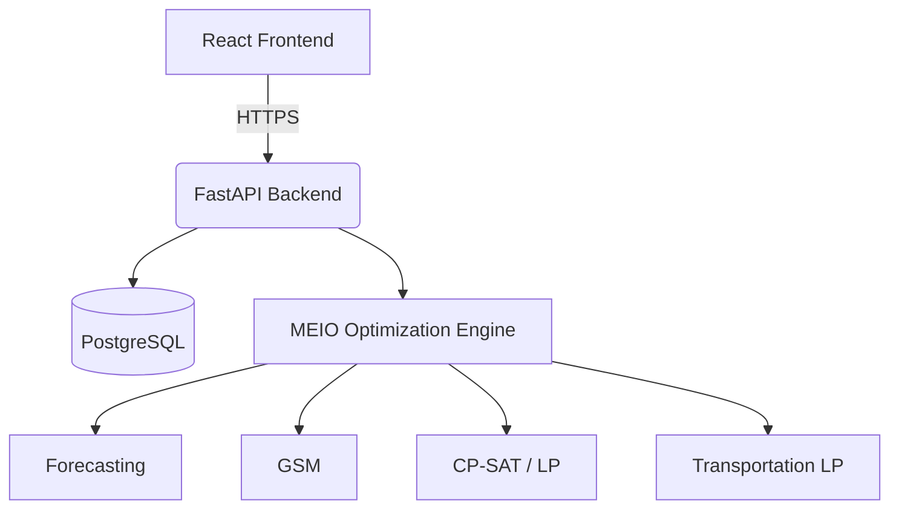

# MEIO Platform

Multi-Echelon Inventory Optimization (MEIO) Platform.

## Architecture

## Tech Stack
- **Frontend**: React (Vite, TypeScript)
- **Backend**: FastAPI (Python)
- **Database**: PostgreSQL
- **Optimization**: OR-Tools (CP-SAT/LP), custom modules
- **Infrastructure**: Docker, GitHub Actions

## Repository Structure
- `backend/`: FastAPI application, optimization engine, database migrations (Alembic)
- `frontend/`: React application
- `database/`: Database seed scripts and migrations
- `scripts/`: Data generation and pipeline execution scripts
- `.github/`: CI/CD workflows and issue templates

## Local Setup
1. Clone the repository: `git clone <repo> && cd meio-platform`
2. Set environment variables: `cp .env.example .env` and `cp frontend/.env.example frontend/.env`
3. Start Postgres, FastAPI and React: `sudo docker compose up -d --build`
4. Run migrations: `sudo make migrate`
5. Generate synthetic data and seed it: `make generate-data && sudo make reset-seed`
6. Run tests: `sudo make test`

*(Depending on your Docker group permissions, you may need to prefix Docker and Make commands with `sudo`.)*

Access the apps:
- Frontend: http://localhost:5173
- Backend: http://localhost:8000
- API Docs: http://localhost:8000/docs

Trigger a full pipeline run from the terminal with `make run`, or from the Optimization page in the UI.

## Environment Variables
See `.env.example`. Never commit `.env` or any secrets.
Set `API_KEY` to require `Authorization: Bearer <key>` on POST/PATCH endpoints; the frontend sends it from `VITE_API_KEY`.

## Git Workflow
We use a feature branch workflow:
1. `main`: stable, demo-ready
2. `develop`: integration branch
3. `feature/*`: individual development
4. `fix/*`: bug fixes

Use conventional commits: `feat:`, `fix:`, `refactor:`, `test:`, `docs:`, `chore:`, `ci:`.

## CI/CD
GitHub Actions run on every push to `develop` and `main`, as well as on PRs.
- `backend-ci.yml`: Python linting, typing, and tests.
- `frontend-ci.yml`: Node linting, typing, and build.
- `deploy.yml`: Staging deployment from `develop`, production from `main`.

## MEIO Pipeline
`POST /api/v1/network/run` (the Optimization page's **Network run**, `make run`, or the nightly
workflow) runs in the background on the data in the database:
1. **Forecast** every store × SKU series: classify the demand pattern (ADI / CV²), backtest
   Naive, Seasonal Naive, Moving Average, SES, damped Holt, Holt-Winters, Croston, SBA and TSB on
   a holdout window, keep the lowest-MASE model and forecast with a 95% interval.
2. **Roll demand up** the network: each DC and supplier sees the demand it serves downstream.
3. **Optimize** each SKU with the Guaranteed Service Model (CP-SAT, heuristic fallback) to get
   service times, safety stock, reorder point and EOQ per node.
4. **Alert** where on-hand stock is below the new safety stock.
5. **Plan transportation** with a multi-SKU min-cost LP that respects lane capacities.

Poll `GET /api/v1/runs/{id}` for progress; results are at `/api/v1/runs/{id}/results`.

## Database Tables
| Table | Holds |
|---|---|
| `locations` | Suppliers, DCs and stores |
| `products` | SKU catalog with unit cost |
| `lanes` | Transport links between locations (transit days, cost, capacity) |
| `location_product_policies` | Per location × SKU settings: service level, service-time bounds, costs, processing time. A location carries a SKU only if it has a policy for it |
| `demand_history` | Daily sales per store × SKU |
| `inventory_snapshots` | On hand / on order / in transit per location × SKU |
| `demand_forecasts` | Forecasts (with 95% bounds) written by each network run |
| `optimization_results` | Optimized targets per run, location and SKU |
| `pipeline_runs` | Run audit trail: parameters, status, summary |
| `alerts` | Stockout risks, capacity, fallback and transport issues |
| `lead_time_observations` | Reserved for measured lead times |

## Team Responsibilities
- [Name 1]: [Roles/Responsibilities]
- [Name 2]: [Roles/Responsibilities]
